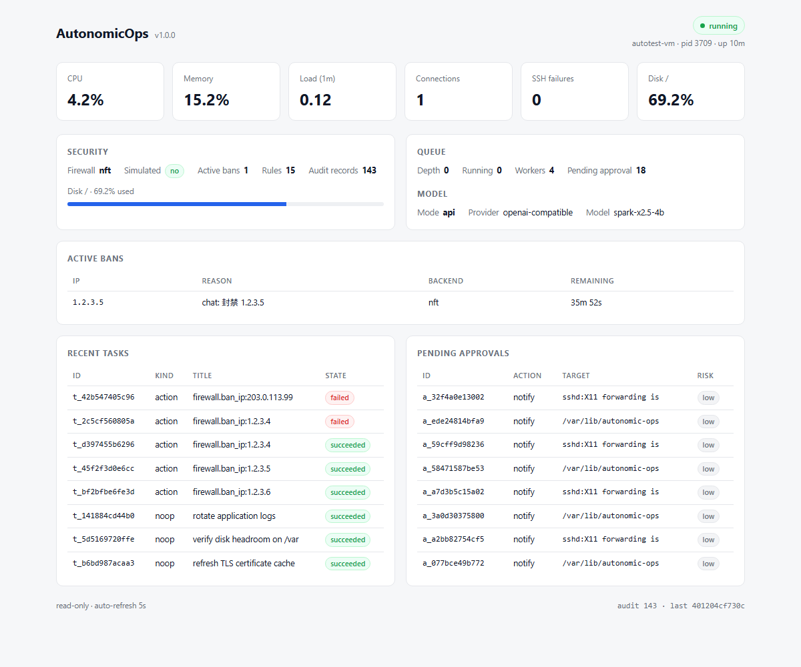

# 只读面板（Read-only Dashboard）

> 一个用 Python 标准库实现的本地只读页面，把 daemon 的状态、指标、封禁、任务与审计集中展示出来。**它不执行任何写操作**——所有变更仍走 CLI 与审批门。



## 1. 它是什么、不是什么

| 是 | 不是 |
|---|---|
| 一个 GET-only 的只读视图 | 一个能点按钮执行命令的 Web 控制台 |
| 通过 daemon 现有 IPC 控制面取数 | 一条能绕过策略门 / 审批队列的旁路 |
| 零第三方依赖（`http.server` + 原生 HTML/CSS/JS） | 需要 Node / React / 数据库的前端工程 |
| 默认只绑 `127.0.0.1` | 默认对局域网或公网开放 |

设计取舍很明确：AutonomicOps 是一个 **root 权限的运维代理**，把它的控制面做成可写的 Web 后台，等于把 XSS / CSRF / 弱鉴权直接放大成 root RCE。所以面板只做「看」，写操作留在 CLI + `pending/approve` 的审批链里，可审计、可脚本化、攻击面最小。

## 2. 启动

```bash
# 需要 daemon 已运行，且以 root 启动（IPC token 在 0600 的 run 目录里）
sudo autonomic-ops serve
# → http://127.0.0.1:8787/

# 换端口 / 指定绑定地址
sudo autonomic-ops serve --bind 127.0.0.1:9000

# 局域网访问：必须显式给 token，否则拒绝绑定非回环地址
sudo autonomic-ops serve --bind 0.0.0.0:8787 --token "$(openssl rand -hex 16)"
# 首次访问带 ?token=<token>，之后用 cookie；不带 token 一律 401
```

源目录运行（开发）：

```bash
PYTHONPATH=src python3 -m autonomic.cli -c config/config.selftest.yaml serve
```

> 注意：面板依赖 daemon 的 Unix socket 与 token，**daemon 没起来时页面会显示 “daemon unreachable”**，这是预期行为。

## 3. 安全模型

1. **GET-only**：只实现了 `do_GET`，没有 POST/PUT/DELETE；不存在任何写入口。
2. **复用 IPC 控制面**：每个 `/api/*` 都通过 `IPCClient.call()` 走与 CLI 完全相同的 token + `SO_PEERCRED` 校验，daemon 侧的权限判定一条都不少。
3. **默认只绑回环**：`--bind` 为非回环地址时，没有 `--token` 直接拒绝启动。
4. **token 校验**：非回环模式下，每个请求都校验 `?token=` 或 `ao_token` cookie，失败返回 401。
5. **响应头**：`X-Content-Type-Options: nosniff`、`Referrer-Policy: no-referrer`，HTML 带 CSP。
6. **不泄露内部**：IPC 报错只回稳定错误串，不回 Python traceback。

即便面板被同网段的人看到，他最多也只能看到只读信息；想封 IP、批准动作、执行命令，仍然必须拿到 shell 并走审批。

## 4. 页面内容

| 区块 | 数据来源（IPC 命令） |
|---|---|
| 顶部状态（版本 / 节点 / PID / 运行时长 / running） | `status` |
| 指标卡（CPU / 内存 / 负载 / 连接数 / SSH 失败 / 磁盘） | `status.metrics` |
| Security（防火墙后端、simulated、活动封禁、规则数、审计条数、磁盘条） | `status.security` / `status.rules` / `status.audit` |
| Queue（深度 / 运行中 / Worker 数 / 待审批数） | `status.queue` / `status.pending_approval` |
| Active bans | `bans` |
| Recent tasks（含已完成） | `tasks`（`all: true`） |
| Pending approvals | `pending` |
| 底部审计摘要 | `status.audit` |

每 5 秒自动刷新一次；页面本身不轮询 daemon 以外的任何东西。

## 5. 接口一览（只读）

| 路径 | 返回 |
|---|---|
| `GET /` | 面板 HTML |
| `GET /api/status` | daemon 完整状态 |
| `GET /api/bans` | `{backend, bans[], simulated}` |
| `GET /api/tasks` | `{tasks[]}`（含终态，最多 20 条） |
| `GET /api/pending` | `{pending[], count}` |
| `GET /api/rules` | `{rules[], stats}` |
| `GET /api/audit` | `{records[]}`（审计尾，默认 25 条） |

所有接口统一返回 `{"ok": true, "data": ...}`；daemon 不可用时返回 `503 {"ok": false, "error": "..."}`。

## 6. 二次开发

面板就是一个模块：`src/autonomic/dashboard.py`。

- **改外观**：直接编辑文件里的 `HTML` 常量（纯 HTML/CSS/JS，无构建步骤）。
- **加只读接口**：在 `Handler.do_GET` 的 `mapping` 里加一项 `"你的名字": ("ipc命令", {参数})` 即可，前端 `fetch("/api/你的名字")`。
- **加写操作**：**不建议**。如果确实需要，务必：默认只绑回环、强制 token、加 CSRF 防护，并且复用 daemon 现有的审批管线，**绝不在面板里直接调 executor**。

如果你只是想要监控数据，也可以不用面板，直接用：

```bash
sudo autonomic-ops status --json | jq .
sudo autonomic-ops metrics | jq .
```

## 7. 常见问题

**能不能让面板执行封禁/批准？**
不做。这是刻意的安全边界。需要自动化就用 `autonomic-ops chat` / `submit` + 审批，或用系统 cron 调 CLI。

**面板要不要单独开 systemd 单元？**
默认不用（按需 `autonomic-ops serve` 即可）。若要常驻，可自己写一个 unit，`ExecStart=/opt/autonomic-ops/bin/autonomic-ops serve`，并保持只绑回环。

**为什么截图里的数据是演示数据？**
README / 本文的截图来自一次性测试 VM，任务、封禁、待审批都是测试过程中真实产生的记录，不是 P 图。
